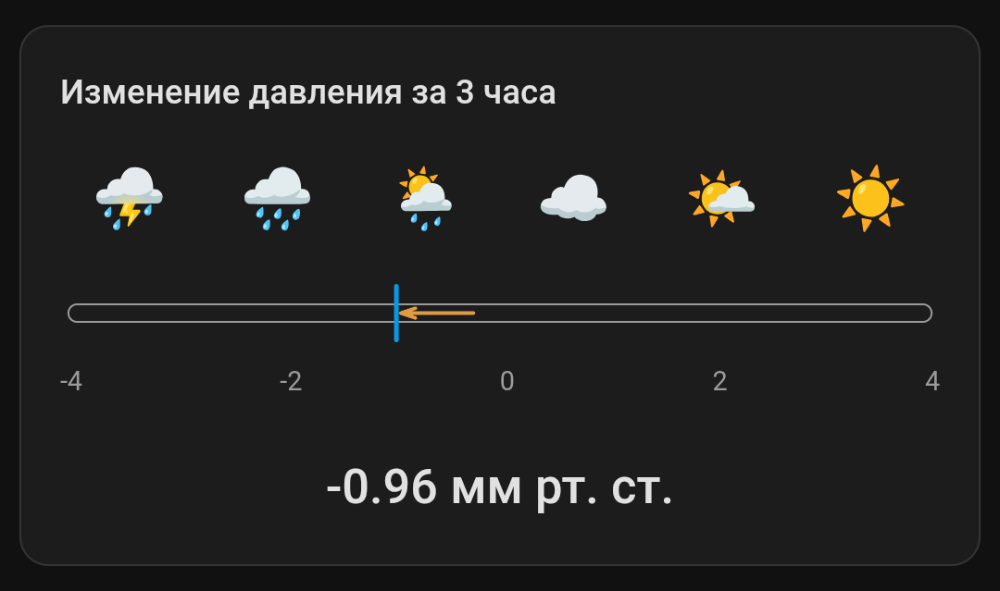

# PirateCast

**Пиратский прогноз погоды для Home Assistant.** Arr! 🏴‍☠️



PirateCast добавляет в ваш дом атмосферный «барометр старого морского волка»:

- сенсоры **изменения атмосферного давления** за 1 и 3 часа;
- наглядную **карточку тенденции давления** — со шкалой, маркером и стрелкой «растёт / падает»;
- всё это устанавливается одной интеграцией, а карточка регистрируется автоматически — вручную ничего прописывать не нужно.

## Установка через HACS

1. HACS → **Integrations** → `⋮` → **Custom repositories**.
2. URL: `https://github.com/devil2012devil/PirateCast`
3. Category: **Integration**.
4. Установите **PirateCast**, перезапустите Home Assistant.
5. **Настройки → Устройства и службы → Добавить интеграцию → PirateCast**.
6. Укажите исходный сенсор атмосферного давления (например, `sensor.atmosfernoe_davlenie`).

После этого появятся сенсоры:

- `sensor.piratecast_pressure_change_1h`
- `sensor.piratecast_pressure_change_3h`

а карточка `custom:piratecast-card` станет доступна в списке карточек Lovelace.

## Карточка

```yaml
type: custom:piratecast-card
entity: sensor.piratecast_pressure_change_3h
title: Изменение давления за 3 часа
min: -4
max: 4
